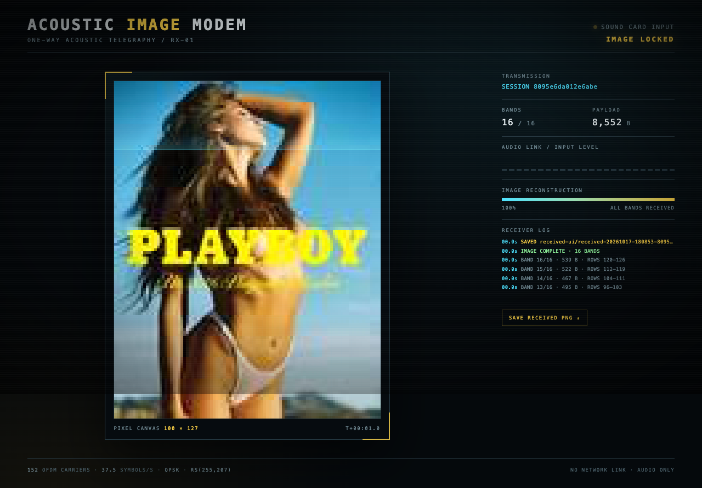

# Acoustic Image Modem

Send a picture from one computer to another using **only sound**.

This is a one-way acoustic modem. The transmitter turns the image into a series
of JPEG bands, protects every band with Reed–Solomon forward error correction,
and sends those bands as an OFDM radio-style signal through a speaker. The
receiver listens on a microphone and paints the picture into a live browser
dashboard, pixel by pixel, as each band arrives.



```
 source image
      │
      ▼
 JPEG bands ──► header + RS(255,207) ──► bit interleaver ──► QPSK
                                                         │
                                             OFDM / 152 carriers
                                                         │
                                                    🔊 speaker
                                                         │
                                                    🎙️ microphone
                                                         │
                            chirp detect ──► channel estimate
                                                         │
                           header FEC ──► payload FEC ──► JPEG band
                                                         │
                                              live browser canvas
```

## What you get

- `acoustic-send` — prepares the picture, plays the modem audio and prints the
  band schedule.
- `acoustic-receive` — listens to the microphone and serves a local dashboard.
  The browser draws each band in a moving pixel-scan, so you can watch the image
  materialize while the transfer is audible.
- A custom OFDM physical layer with chirp sync, pilot phase tracking,
  frequency-diversity QPSK, 48-byte Reed–Solomon parity per 255-byte block, bit
  interleaving, and CRC32 framing.
- Independent band packets: a lost band only leaves a horizontal strip missing;
  use `--repeat 2` in difficult rooms.

## Install

Requires Python 3.10+ and PortAudio.

macOS:

```bash
brew install portaudio
uv venv --python 3.14
uv pip install -e .
```

If you do not use `uv`:

```bash
python3 -m venv .venv
source .venv/bin/activate
pip install -r requirements.txt
pip install -e .
```

## Send

On the computer with the speaker:

```bash
source .venv/bin/activate
python send.py source_image.jpg
```

Or with the installed command:

```bash
acoustic-send source_image.jpg
```

Useful options:

```bash
acoustic-send source_image.jpg --width 100 --band-rows 8 --volume 0.50
acoustic-send source_image.jpg --repeat 2      # more robust, takes twice as long
acoustic-send --list-devices                  # output device indices
acoustic-send source_image.jpg --device "MacBook Air Speakers"
acoustic-send source_image.jpg --wav transmission.wav --no-play
```

Turn the computer volume up to a comfortable level, keep the speaker facing the
receiver, and avoid muting the output. The transmission takes roughly 25–35
seconds for a 100-pixel-wide picture, depending on JPEG band sizes and repeats.

## Receive

On the other computer:

```bash
source .venv/bin/activate
python receive.py
```

Or:

```bash
acoustic-receive --port 8765
```

A browser opens at <http://127.0.0.1:8765/>. If you are running the receiver on
a headless machine, open that URL from another machine on the same network and
bind with `--host 0.0.0.0`:

```bash
acoustic-receive --host 0.0.0.0
```

Pick a microphone explicitly if needed:

```bash
acoustic-receive --list-devices
acoustic-receive --device "MacBook Air Microphone"
```

Completed pictures are written to `received/` as PNG files. The page also has a
download link once every band is present.

### Test without a second computer

Build a WAV and decode it offline:

```bash
acoustic-send source_image.jpg --wav transmission.wav --no-play
acoustic-receive --wav transmission.wav --no-browser
```

Then open <http://127.0.0.1:8765/> to watch the decoded bands reveal.

## Tuning the room

The modem is designed for ordinary laptop speakers and microphones at
conversational distance.

- Start with `--volume 0.50` (the default). If the receiver hears nothing, raise
  it; if you hear crackling/distortion, lower it. A lower volume often works
  *better* on nearby laptops because it avoids microphone AGC and speaker
  distortion.
- Keep the receiver's input gain moderate. AGC that pumps heavily during the
  chirp can hurt; disabling “voice isolation” or aggressive noise suppression on
  the microphone often helps.
- On macOS, the receiver asks for a 1-second input buffer. That keeps the audio
  device from dropping samples while Python is busy demodulating a packet.
  `--record capture.wav` preserves the microphone audio if you need to diagnose
  a bad room.
- `--threshold` controls chirp detection (default `0.19`). Lower it to
  `0.12`–`0.15` in a very quiet or very reverberant room; raise it if background
  music produces false starts.
- If some bands are lost, run the sender with `--repeat 2`, or increase the JPEG
  quality/band size only after the link is reliable. Sending a narrower image
  (`--width 80`) is the easiest way to make a link more robust.
- The signal lives between about 750 Hz and 7.8 kHz, so speakers with a “bass
  boost” or strong spatial processing should be set to a neutral profile.

## Protocol notes

| Parameter | Value |
|---|---|
| Sample rate | 48,000 Hz |
| Occupied band | 750–7,830 Hz |
| FFT / cyclic prefix | 1024 / 256 samples |
| Subcarrier spacing | 46.875 Hz |
| Data carriers | 133 (plus 19 pilots) |
| Modulation | QPSK, each payload symbol repeated on 2 carriers |
| Symbol rate | 37.5 symbols/s |
| Payload FEC | RS(255, 207), 48 parity bytes |
| Header protection | RS(255) + two header copies |
| Framing | chirp + 4 training symbols + header + payload |
| Image transport | one independently decodable JPEG strip per band |
| Receive buffer | 1 s, so CPU work cannot cause audio dropouts |

The image is not sent as one file. Each horizontal strip is compressed on its
own and becomes a packet. That is what makes the progressive reveal possible:
the receiver can display a strip the moment its packet passes CRC, without
waiting for the rest of the picture.

## Files

```
acoustic_modem/
  config.py       physical-layer constants
  protocol.py     image bands, headers, Reed–Solomon framing
  dsp.py          chirp, OFDM modulation/demodulation, sync and equalization
  send.py         transmitter CLI
  receive.py      microphone receiver CLI
  webui.py        Flask + SSE dashboard
  templates/
    receiver.html pixel-reveal canvas interface
tests/            loopback and simulated-channel tests
```

## Limitations

This is a broadcast link, not a two-way protocol. There is no ACK/retransmit
handshake, so the sender cannot know which bands the receiver missed. The
receiver's dashboard shows missing bands, and the sender's `--repeat` option is
the simple remedy. Audio echo cancellation, microphone AGC and strong room noise
can all reduce throughput; the FEC and interleaver are there to absorb a useful
amount of that, not to make an unbreakable link.

## License

MIT. See [LICENSE](LICENSE).
